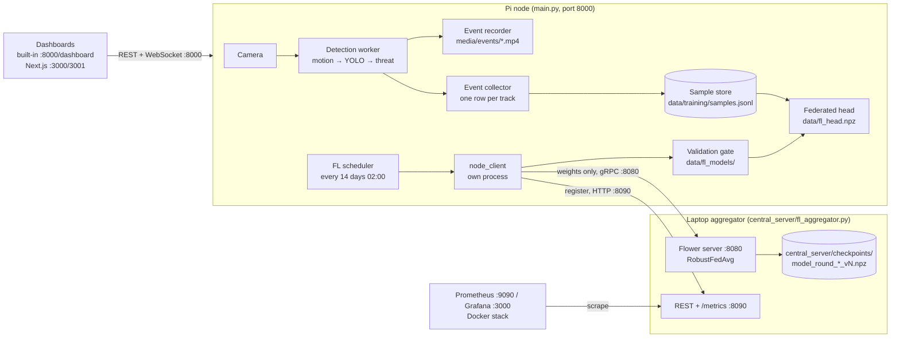

# Where everything is, and how it talks

One page for finding things: the machines, the URLs, where data lives,
where simulations run and write, and how the parts connect.

## How the parts talk

Only model weights cross the network. Video, stills and feature vectors stay on the node.

## Machines and URLs

| Machine | Address | What to open |
|---|---|---|
| Pi, Node A | `10.0.0.140`, user `viccia`, repo `~/argus` | `http://10.0.0.140:8000/dashboard` (live view), `:8000/docs` (API), `:8000/api/detection/status`, `:8000/api/federated/status` |
| Laptop aggregator | `10.0.0.239` | `http://localhost:8090/api/status`, `/api/nodes`, `/api/training/summary`, `/api/training/history`, `/metrics` |
| Docker monitoring (optional) | laptop | Grafana `http://localhost:3000` (admin/argus), Prometheus `http://localhost:9090` |
| Product dashboard | laptop | `.\scripts\run_dashboard.ps1 -Node 10.0.0.140` → `http://localhost:3000` or `3001` (3001 when Grafana holds 3000) |
| Node B | not built yet | same layout as Node A, its own `NODE_NAME` |

Firewall rule on the laptop, once, elevated PowerShell:
`New-NetFirewallRule -DisplayName 'ARGUS FL' -Direction Inbound -Protocol TCP -LocalPort 8080,8090 -Action Allow`

## Where data lives

| Data | Where | Notes |
|---|---|---|
| Real labelled events (322) | Pi `~/argus/data/training/samples.jsonl` | The only data from our own camera. Copy with `scp viccia@10.0.0.140:~/argus/data/training/samples.jsonl .` |
| Event stills and crops | Pi `~/argus/data/snapshots/` | |
| Event clips | Pi `~/argus/media/events/` | Nothing deletes these yet |
| Live model, versions, gate history | Pi `data/fl_head.npz`, `data/fl_models/`, `data/fl_model_state.json` | Rollback: `POST /api/federated/head/rollback` |
| Each round's files | Pi `data/fl_rounds/<timestamp>/` | `init.npz`, `global.npz`, `events.jsonl` |
| Global model checkpoints | Laptop `central_server/checkpoints/` | Version resumes from these on restart |
| Base head dataset (in progress) | Laptop `data/base_dataset/training/samples.jsonl` | 13 events from public traffic clips |
| COCO val2017 | Laptop `data/datasets/coco/` | From `compare_detectors.py --prepare` |
| Weapon datasets | Laptop `data/datasets/weapons/` | Download paused; see `docs/research/threat-eval.md` |
| MEVA (next) | Laptop `data/datasets/meva/` | See `docs/research/datasets.md` |
| Benchmark outputs | Laptop `data/benchmarks/` | `detector_compare_<date>.md/.json` |
| Public clips used | Laptop `media/public/` | Intel sample videos, CC-BY-4.0, `ATTRIBUTION.txt` |
| Reports, decks, PDFs | `Dropbox/argus/argus/` | Biweekly reports in `progress-reports/` |
| Fine-taxonomy code + Stanford Cars | Second dev machine: `argus-fl` on `feat/fine-taxonomy`, `D:\argus-data` | Not on GitHub yet |

`data/` and `media/` are gitignored. Nothing in them is backed up by git.

## Simulations: where to run, where results land

| What | Run | Results |
|---|---|---|
| Multi-client FL, real gRPC | `python sim/fl.py serve --rounds 3 --clients 3 [--aggregation fedavg]` then one `python sim/fl.py client --site driveway\|backdoor\|yard` per client | `sim/_run/fl_events.jsonl` (`kind: fit`, `evaluate`, `aggregation`, `server_done`) |
| One node under load while a round runs | `python sim/run_node.py [--clients 3 --rounds 6] [--profile pi5-hailo]` | Console summary; live metrics `http://127.0.0.1:9108/metrics` |
| Local aggregator + one round on the Pi | `./scripts/fl_trial.sh` | Pi `data/fl_rounds/`; gate decision printed |
| Detector comparison | `python scripts/compare_detectors.py` | `data/benchmarks/` |
| Fine taxonomy (other machine) | `python sim/compare_taxonomy.py`, `sim/run_node.py --taxonomy fine` | `sim/_run/taxonomy_report.md/.json` |
| Threat threshold | `python scripts/tune_threat_threshold.py --dataset ... --negatives ...` | Console table |

Synthetic sites live in `sim/workload.py` (19 features) and, on the fine-taxonomy branch, `sim/workload_fine.py` (35).
They are the "fake Pi" clients until MEVA cameras replace them.

## Where to look when something is off

| Question | Look at |
|---|---|
| Is the node detecting? What backend? | `:8000/api/detection/status`, `./scripts/node_status.sh` |
| When is the next round? | `:8000/api/federated/status` |
| Why was a model accepted or rejected? | `:8000/api/federated/head` → `last_decision`; `data/fl_model_state.json` |
| Did the aggregator drop someone's update? | `:8090/api/training/history` → `aggregation`; metric `argus_fl_rejected_updates_total` |
| Node logs (once the service is installed) | `journalctl -u argus-node -f` |
